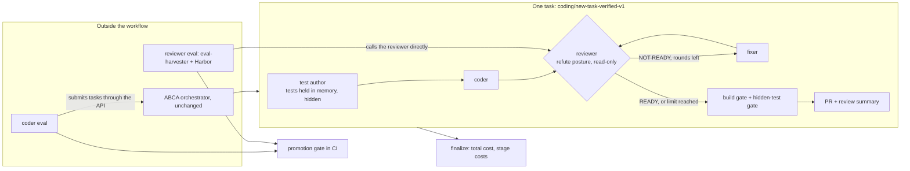

# Factory Plan: Learning Software Factory on ABCA

> Where this file lives: drafted at `kiro_projects/Autonomous agents/FACTORY_PLAN.md`. In Task 1, copy it into your fork as `docs/lab/FACTORY_PLAN.md` so Claude Code can read it in every session.

## Lab decisions log

- **2026-11-16 (Task 1):**
  - **AWS account:** the lab shares non-prod account `<lab-account-id>` (`us-east-2`) rather than a dedicated account per the Requirements section above; revisit before Task 2's deploy if isolation becomes a problem. The real account id is kept only in the untracked, gitignored `.local.env` at the repo root — never commit it.
  - **Agent AWS credentials:** `AWS_PROFILE=factory-bedrock`, assuming role `factory-bedrock-invoke`, which is scoped to only `bedrock:InvokeModel` / `bedrock:InvokeModelWithResponseStream` on Anthropic models and inference profiles. No admin or broader credentials are used for agent runs.
  - **GitHub token:** the fine-grained PAT for `factory-sandbox-py` lives in the macOS Keychain under service name `factory-sandbox-pat`, read inline per command (`GITHUB_TOKEN="$(security find-generic-password -s factory-sandbox-pat -w)"`) — never exported persistently or printed.
  - **Git hooks:** `core.hooksPath` stays pointed at git-defender (system scope, unchanged); `prek install` is skipped for this repo rather than overriding it. Substitute: run `mise run build` and `mise run security` manually before every commit here.
- **2026-11-16 (Task 2):**
  - **Deployed features:** `backgroundagent-dev-factory` went up with every optional feature (Slack, Linear, Jira, deploy-preview screenshots, Agent Registry, Tool Gateway) via the interactive `bgagent setup` wizard, not the plan's `--features none`. Audited every new route this adds: each is either Cognito-authenticated or HMAC-verified in its Lambda handler (no gateway-level `NONE` auth without an in-handler signature check); see `docs/lab/LAB_LOG.md`'s Task 2 entry for the full table.
  - **CDKToolkit bootstrap:** the account's existing bootstrap is the vanilla default (CloudFormation execution role = `AdministratorAccess`), not ABCA's own least-privilege policy bundle (`cdk/src/bootstrap/policies/`). Reused as-is (matches the precedent already set by the stock `backgroundagent-dev` stack); a separately-qualified least-privilege bootstrap is deferred to the hardening backlog rather than done now, since it would be new, untested surface area for a single-task deploy.
  - **Idle cost:** roughly $149/month for the stack's always-on resources, ~90% of it the VPC NAT Gateway + 7 interface endpoints that AgentCore's private-networking design requires — not something this task's scope can reduce while keeping AgentCore and the current security posture.
- **2026-11-18 (Planning):** Added Tasks 13–15 to the task breakdown — outbound Jira issue creation + auto-tracking (13), Confluence publishing for generated documentation (14), and a feature-planning workflow that decomposes an unscoped request into Jira stories/subtasks plus a Confluence doc (15) — after confirming during the Jira setup session (`docs/lab/LAB_LOG.md`'s Task 2b continued) that ABCA has zero outbound Jira/Linear issue-creation and zero Confluence integration today. **Decided order:** Track A (Task 3 → 4 → 5) runs first, then Track B (Task 13 → 14 → 15), one task at a time, never in parallel; Tasks 6–12 are deferred until both tracks are done.
- **2026-11-18 (Planning, continued):**
  - **Deferred tasks and order:** Tasks 6–12 are marked Deferred (later) in the task breakdown, content kept unchanged. Active sequence is Task 3 → 4 → 5 → 13 → 14 → 15 → 15.5 → 16 → 17, run sequentially, never in parallel.
  - **Reviewer redesign (Tasks 4/5):** the coder writing both the code and its own tests is a conflict of interest, so the reviewer gets independent testing via probe tests instead of relying on the coder's. Two separate agent calls: Call 1 (probe writer) sees only the issue and the base-branch code, never the diff, and writes probes into a scratch directory outside the repo; a deterministic step (not an agent) runs those probes against the coder's version; Call 2 (code reviewer) sees the issue, the diff, and the probe results, and does the white-box review. Failing probes and evidence-backed findings both count toward the READY/NOT-READY verdict.
  - **Probes are committed by a deterministic step, never by the reviewer:** before `ensure_pr`, the probes that pass on the final code are committed into `tests/review_probes/` as a separate commit; failing probes are listed as unresolved findings and never committed. The human decides at merge whether to keep them.
  - **Confluence confirmed:** Confluence Cloud is on the same Atlassian site as Jira — no separate site/tenant onboarding needed for Task 14.
  - **Jira orchestration confirmed:** `docs/guides/JIRA_SETUP_GUIDE.md`'s "Authored subtask orchestration" section is backed by real code (`jira-webhook-processor.ts`, `orchestration-channel-jira.ts`) and a passing test suite (`jira-webhook-processor-orchestration.test.ts`, 13/13) — not Linear-only documentation. Task 15 relies on this existing routing rather than building new orchestration logic.
  - **Task 15 requires Slack approval before filing anything:** the proposed epic/stories, an estimated cost (from the Task 3 ledger averages), and a Confluence draft link are posted to Slack with Approve/Revise/Cancel buttons; only a Slack user linked to a factory Cognito user can approve; plans over a story-count or cost threshold need a second confirmation; unanswered plans expire with nothing filed; the approver and time are recorded on the Jira parent.
  - **Fork-only scope:** All changes from Task 3 on are confined to this fork. Nothing is proposed or contributed upstream to `aws-samples`. ADRs are fork ADRs, titled "ADR-0NN (fork): …". ABCA's ADR-003 issue-approval rule applies within the fork: the owner adds the `approved` label to each issue before work starts. PRs always target the fork's `main`, never `aws-samples`. `LICENSE` and `NOTICE` are kept.
- **2026-11-18 (Rollback and safety):** Rollback and safety checklist adopted; first known-good tag is `known-good-task2b`. Second tag, `known-good-task3`, after Task 3's deploy and smoke test (`coding/new-task-v1` on `factory-sandbox-py`, `build_passed: true`).
- **2026-11-18 (Planning: Tasks 15.5–17):** Added Task 15.5 (switch the target app repo), Task 16 (IaC and pipeline deploys for the target app repo), and Task 17 (preview smoke test and opt-in auto-merge on green) to Track B, after Task 15. **Decided order:** Track B is now 13 → 14 → 15 → 15.5 → 16 → 17.
  - **Same AWS account as the factory** — a demo, not a multi-environment setup. App resources use their own stack names and the tag `project=factory-sandbox-app`.
  - **Repo-agnostic design:** the "target app repo" is any repo onboarded to the factory. App-specific files (GitHub Actions workflows, CDK app, build command) live in each app repo. Factory-side settings are per repo in ABCA's repo config. Never hardcode a repo name.
  - **Tasks 16–17 target web-facing apps.** Frontend previews use AWS Amplify Hosting PR previews, which ABCA's deploy-preview screenshots support natively via Amplify `check_run` events, and Amplify deletes previews when a PR closes. Backend resources use AWS CDK, reusing the account's existing CDK bootstrap. No Terraform.
  - **GitHub Free plan:** Actions works on private repos (2,000 minutes a month), but required status checks can't block merges on private repos. So the factory, not GitHub, enforces "never merge red". Actions is enabled on target app repos only, never on the ABCA fork.
  - **Preview exposure decision:** previews are public so screenshots work. This is acceptable for the demo only because they contain demo data only (no real users, secrets or internal content) and are deleted when the PR closes. It's a knowing, documented exception to private-by-default, recorded in the Task 17 ADR.
- **2026-11-18 (Planning: MVP is the delivery factory):** MVP is the delivery factory (ticket → verified PR → preview → auto-merge); planning (Confluence, feature planning) layers on after. **Reordered:** Track A (3 → 4 → 5), then the MVP delivery track (15.5 → 13 → 16 → 17), then Layer 2, the planning track (14 → 15). 15.5 moves before 13 so Jira auto-tracking is built on the repo the lab keeps, not on `factory-sandbox-py`, which 15.5 switches out. Task 15.5's new repo must be a web app with a testable backend or component layer, so reviewer probes (Tasks 4/5) stay meaningful against it.
- **2026-11-18 (Planning: Task 15.5 becomes additive, not a swap):** Supersedes the "switches out" language above. Task 15.5 now **adds** `factory-shop` as a second target app repo rather than replacing `factory-sandbox-py`; `factory-sandbox-py` stays onboarded as the Rollback-and-safety-checklist smoke-test repo, and nothing is offboarded. `factory-shop` gets its own repo settings (build command, default workflow, auto-merge opt-in reserved for Task 17) and its own new Jira project, independent of the sandbox's existing `SCRUM` mapping. Its stack is a FastAPI (`pytest`) backend plus a Vite/React (`vitest`) frontend — products, cart, mock checkout, demo data only — with one `mise run build` running both suites plus a lint task from day one.
- **2026-11-19 (Planning: Task 15.5 ships with no ABCA code change):** Narrows the "its own repo settings" language above. `build_command`/`lint_command` are already optional per-repo `RepoConfig` fields that default to `mise run build`/`mise run lint` when unset, so `factory-shop` gets build/lint gating for free from its own `mise.toml` — no CDK change. A real per-repo `default_workflow` field was considered, but the codebase deliberately keeps repo-bound workflow defaulting at each channel's call site rather than a resolver-level per-repo field; building it properly is **moved to Task 13** (see that task's new guidance bullet) rather than done here. Both `factory-shop` and `factory-sandbox-py` keep using explicit `--workflow` from the CLI for now. "Auto-merge opt-in" is a GitHub Actions repo variable (`FACTORY_AUTO_MERGE`), not an ABCA field — `factory-shop` simply has no Actions workflow yet, which is Task 17's job. Net effect: Task 15.5 is operational only (new repo, PAT scope, `set-token`, onboarding, a new Jira project/mapping) plus this plan/log write-up; no `autonomous-agents-factory` application code changes.
- **2026-11-20:** Task 17.5 planned and deferred until a second app repo needs auto-merge or deploys.
- **2026-11-22 (Planning: Task 15 becomes a shaped conversation):** A feature request is shaped in conversation before any research runs. When a request is vague, Jarvis asks targeted questions (buttons where possible, at most about three rounds). A detailed request skips straight to research. Shaping happens wherever the PM starts it, in a channel thread or a DM. The Confluence planning doc is the main review point, and the Slack message carries only a summary, a link and the Approve/Revise/Cancel buttons. Only the requesting PM can approve. On Approve, Jarvis re-reads the doc as edited, flags problems and asks the PM to confirm before filing. Revisions can come from a Slack reply, a direct doc edit, or both, and Jarvis never overwrites the PM's edits. Open requests expire after 7 days, with a reminder after 2 idle days. Plans over the story-count or cost threshold need a second confirmation from the PM that shows the story count and estimated cost. In team use this becomes a named second approver. Task 14 gains page read-back, edit detection and draft/final page state to support this.

## How to use this plan with Claude Code

- **One task per session.** A session is one Claude Code conversation (from `claude` until you exit or type `/clear`). Do one task, check it, merge it, then start a fresh session for the next task. Long conversations fill Claude Code's context and quality drops; each task is a checkpoint. The plan file, code, tests and merged PRs carry everything forward between sessions.
- **Prompt for each session:** "Read docs/lab/FACTORY_PLAN.md. Do Task N only. Propose your approach first, then write the tests, then the code. Follow AGENTS.md. Stop when the Demo works. Write the exact demo steps and expected results into the PR description."
- **Run the demo yourself.** Every task ends with a Demo line describing what you should see working. Follow the steps in the PR description and check the result with your own eyes; don't rely on Claude Code saying "done". If it doesn't behave as described, have Claude Code fix it before merging.
- **Per-task loop (ABCA conventions):** open a GitHub issue in your fork → branch → `mise run build` → `/commit` → PR → `/review_pr` → run the demo → merge.
- **From Task 3 onward** you can let the factory build parts of itself: `bgagent submit --issue N` on a well-written issue. Review those PRs closely.

### Rollback and safety

Follow this checklist in every task from now on.

- **Known-good tags.** After each task's demo passes and its PR is merged, tag `main` as `known-good-taskN` (for example `known-good-task3`) and push the tag:
  ```bash
  git checkout main && git pull origin main
  git tag known-good-taskN
  git push origin known-good-taskN
  ```
- **Lab exception to "never edit on `main`" ([ADR-003](../decisions/ADR-003-contribution-governance.md)):** a post-merge `docs/lab/LAB_LOG.md` wrap-up entry and the `known-good-*` tag above may be pushed directly to `main`, with no issue or PR. Everything else — code, infrastructure, policy, workflow files, ADRs, any change that isn't a LAB_LOG wrap-up entry or a known-good tag — still goes through an approved issue and a PR, with no exception.
- **Rollback.** If a deploy breaks the factory, check out the latest `known-good-*` tag, rerun the standard deploy command, then return to `main` and fix the problem on a branch:
  ```bash
  git checkout known-good-taskN

  AWS_PROFILE=factory-base AWS_REGION=us-east-2 ABCA_SKIP_BOOTSTRAP_PREFLIGHT=1 \
    mise //cdk:deploy -- \
    -c stackName=backgroundagent-dev-factory \
    -c deploymentProfile=abca.deployment.backgroundagent-dev-factory.json \
    --all --require-approval broadening --tags project=software-factory

  git checkout main
  git checkout -b fix/<issue-number>-<short-description>
  ```
- **Diff before deploy.** Before every deploy, run `mise //cdk:diff` with the same context and give a one-line summary:
  ```bash
  AWS_PROFILE=factory-base AWS_REGION=us-east-2 ABCA_SKIP_BOOTSTRAP_PREFLIGHT=1 \
    mise //cdk:diff -- \
    -c stackName=backgroundagent-dev-factory \
    -c deploymentProfile=abca.deployment.backgroundagent-dev-factory.json
  ```
  Stop and wait for approval only if the diff replaces or deletes a resource, or changes IAM or security groups. Otherwise, proceed. Version resources (`Lambda::Version`, `GuardrailVersion`) and timestamp-only `Custom::AWS` replacements don't trigger the stop rule; tables, user pools, secrets, VPC/network resources, functions and buckets do.
- **IAM/security-group approval happens at the diff step.** When the diff has IAM or security-group changes, get approval there. The deploy that follows immediately (no merges in between) uses `--require-approval never`, because `mise` runs without a TTY and CDK's own approval prompt can't appear.
- **Smoke test after deploy.** After every deploy, submit one small task on `coding/new-task-v1` against `factory-sandbox-py` and confirm it opens a PR with `build_passed: true`. Only then test new workflows.
- **Opt-in only.** New behaviour goes in new workflows such as `coding/new-task-verified-v1`. Never change `coding/new-task-v1` or the repo's default workflow without explicit approval.
- **Rebuild the CLI after a `cli/` merge.** After any merge that changes `cli/`, rebuild the CLI with `MISE_EXPERIMENTAL=1 mise //cli:build` before using `bgagent` — a stale `cli/lib/` silently runs the old command behavior with no error.

## Problem statement

Build a software factory you can learn from piece by piece: orchestrator, deterministic engine, adversarial review, test independence, observability, cost and evaluation. Start as a lab in a non-prod AWS account (learning) and grow into a team tool. Build on a fork of ABCA (aws-samples/sample-autonomous-cloud-coding-agents). Borrow patterns from AI-DLC v2, but no AI-DLC code.

## Requirements

- **Environment:** a dedicated non-prod AWS account and private GitHub repos created for the lab.
- **Repos and folders:**
  - The existing stock clone at `kiro_projects/Autonomous agents/sample-autonomous-cloud-coding-agents` stays unchanged, for experimenting with ABCA as-is.
  - All factory work happens in a separate Claude Code project folder, holding a clone of your own GitHub fork of ABCA.
  - The fork is for your own use. It does not need to merge back upstream or follow ABCA V2. An `upstream` remote is optional, only for picking up specific fixes such as security patches.
- **Fork-only scope:** All changes from Task 3 on are confined to this fork. Nothing is proposed or contributed upstream to `aws-samples`. ADRs are fork ADRs, titled "ADR-0NN (fork): …". ABCA's ADR-003 issue-approval rule applies within the fork: the owner adds the `approved` label to each issue before work starts. PRs always target the fork's `main`, never `aws-samples`. `LICENSE` and `NOTICE` are kept.
- **Tools:** Claude Code builds the project. The factory's coder runs on the Claude Agent SDK on Amazon Bedrock. Kiro is not required.
- **Budget:** no number fixed yet. The build produces cost data per task and per stage to inform that decision.
- **Opt-in:** existing ABCA workflows stay unchanged. New behaviour lives in a new workflow, `coding/new-task-verified-v1`.
- **Bug fixes and security patches** use the same workflows as features. There is no separate bugfix workflow; the test author's regression test covers that case.
- **Reviewer rules** (adapted from AI-DLC v2). Each rule prevents a known failure of LLM reviewers:
  - It sees only the issue and the diff, never the coder's reasoning. This prevents rubber-stamping.
  - It works from a "refute it" posture: READY is the verdict it fails to reach after hunting. This prevents leniency.
  - Only findings backed by evidence (file, line, tool or test output) can block. This prevents false alarms.
  - The verdict is a single READY or NOT-READY line, and code assigns the finding IDs.
  - Code caps the fix loop, by default at 2 rounds. This prevents endless loops.
  - A review that doesn't finish is retried once, then counts as NOT-READY. This prevents silent passes.
  - A verdict is tied to the commit SHA it reviewed. This prevents stale approvals.
  - It has its own turn cap.
  - Each workflow sets the review mode: `advisory`, `adversarial` or `none`.
- **Test author:**
  - A separate agent writes acceptance tests from the issue, and the coder never sees them.
  - Code checks each test before it counts. The test must fail on the starting code, and for evals it must also pass on a known-good reference.
  - It may mark a task "not testable", which falls back to review only.
- **Models:**
  - The reviewer and test author sit behind a pluggable backend.
  - Start with a different Claude tier, for example Opus for the coder and Sonnet for the reviewer and test author.
  - Add a non-Claude family next. A different family is more independent, with fewer shared blind spots.
  - Choose the model based on eval results.
- **Evals:** they run outside the workflow and test the whole factory.
  - **Coder eval:** cases are generated automatically from injected bugs and mined history, and code verifies each case.
  - **Reviewer eval:** uses eval-harvester (aws-samples/sample-code-eval-harvester), plus seeded flaws and labels taken from coder eval results.
  - **Promotion gate:** CI requires both evals before a workflow can be marked `production`.
- **Conventions:** follow ABCA's: an issue before each PR, mise tasks, tests in `agent/tests`, corpus fixtures, and an ADR for design changes.
- **ADR policy:** write a fork ADR only for significant design decisions: the multi-call reviewer (Tasks 3–5), Confluence auth (14), feature planning and approval (15), IaC deploy policy (16), and auto-merge with public previews (17). Smaller tasks are recorded in their issue, PR and `LAB_LOG.md`.

## Background (from code research)

- Adding a step kind touches `agent/workflows/schema/workflow.schema.json` (the kind enum), `StepKind` in `agent/src/workflow/models.py`, a handler in `STEP_HANDLERS` in `agent/src/workflow/runner.py`, the validator sets in `agent/src/workflow/validator.py`, and corpus fixtures in `contracts/workflow-validation/`.
- On coding tasks, `agent/src/pipeline.py` (`_execute_agent_step`) runs only `run_agent` through the workflow runner (`only_kinds={"run_agent"}`); the build check and PR creation run inline. New steps must therefore be called inline from `pipeline.run_task`, after the coder's agent step and before the post-hooks (the build gate and PR creation). Otherwise they are silently skipped.
- Validator rule-2 allows exactly one `run_agent` per workflow, and ADR-014 defers multi-agent workflows to #99. New ADR-025 records why the new composite steps are an exception.
- `run_agent` (`agent/src/runner.py`) can be called again with `config.model_copy(update={...})`. Three problems:
  - `_setup_agent_env` changes process-wide environment variables (`ANTHROPIC_MODEL`).
  - `max_budget_usd` applies to each call separately.
  - `TaskResult.cost_usd` counts only one agent result.
- No retry or fix loop exists; `convergence: test_gated` only documents behaviour. Nothing enforces `promotion_gate`.
- Steps run through the runner emit `step:*` milestones, which `bgagent watch` shows. `agent/src/observability.py` `task_span` provides OpenTelemetry spans.
- `agent/src/prompts/pr_review.py` defines a reusable findings taxonomy: type, severity, title, description, proposed fix and AI prompt.
- `agent/run.sh` and `DRY_RUN=1` run the agent locally. `bgagent setup --features none` deploys the minimal profile.

## Proposed solution



| Workflow | Steps |
|---|---|
| `coding/new-task-v1` (existing, unchanged) | coder → build check → PR |
| `coding/new-task-verified-v1` (new, opt-in) | test author → coder → reviewer ⇄ fixer → build check + hidden tests → PR |

Choose a workflow per task with `--workflow`, or set a per-repo default. Compare the two workflows with the evals, and make the new one the default once it proves better.

## Things to watch (from the plan review)

1. **Keeping the hidden tests hidden.** The test author and the coder run in the same MicroVM, and the coder has Bash. The step code holds the tests in memory, outside the repo and off disk, while the coder runs, and a test proves they aren't present. This is lab-grade isolation, and stronger isolation is in the backlog.
2. **Tasks that can't be tested** (docs changes, vague issues) fall back to review only, with the reason recorded. The test author must not invent weak tests.
3. **Cost rises three to four times per task,** with up to four agent calls. The shared budget caps the total. Eval runs cost real money too: 10 cases × 2 workflows is 20 full tasks.
4. **Small evals are noisy.** Run each case N times, report ranges, and gate on thresholds rather than single scores.
5. **Lab setup checks:**
   - Make the sandbox repos **private**, so outsiders can't inject instructions through issues.
   - Check that the Claude models are enabled in Bedrock in your Region, and check their throughput quotas.
   - Check which non-Claude model families are available (needed for Task 10).
6. **Two deployments in one account:**
   - The stock clone keeps stack name `backgroundagent-dev`, and the fork uses `backgroundagent-dev-factory`. ABCA's least-privilege bootstrap requires the form `backgroundagent-dev[-suffix]`.
   - Use separate Cognito users and GitHub PATs, or a separate AWS account.
7. **Internal policy:** confirm that Claude Code, with Bedrock as the provider, is approved for this work.
8. **eval-harvester security:** its runner passes AWS credentials to the evaluated agent. Run it only in the lab account with a role scoped to it.

## Task breakdown

### Active order

Track A (Task 3 → 4 → 5) runs first, then the MVP — the delivery factory (Task 15.5 → 13 → 16 → 17) — then Layer 2, the planning factory (Task 14 → 15) — one task at a time, never in parallel. Tasks 6–12 are marked **Deferred (later)** below and are not scheduled until all three groups are done; their content is kept unchanged for when priority is revisited.

### Task 1: Fork, fix local tooling, and run locally
- Objective: a green fork, in its own Claude Code project folder, that runs a real task locally.
- Guidance:
  - On GitHub, fork `aws-samples/sample-autonomous-cloud-coding-agents` into your account or org, private if allowed.
  - Clone **your fork** into the new Claude Code project folder. Do not touch the existing stock clone.
  - Copy this file into the fork as `docs/lab/FACTORY_PLAN.md`.
  - Install with mise: `mise install`, then `mise run install`. If `prek install` fails because `core.hooksPath` is set globally, fix it at repo scope, not in global git config.
  - Create a private sandbox repo, `factory-sandbox-py`: a small Python service with build and test commands.
  - Create a fine-grained PAT scoped to that repo only.
  - Run with `DRY_RUN=1 ./agent/run.sh <owner>/factory-sandbox-py "<task>"`, then do a real run.
- Tests: `mise run build` and `mise //agent:quality` pass.
- Demo: the local agent opens a PR on the sandbox repo.

### Task 2: Deploy the baseline to the lab account and write a component tour

> **Deviation (2026-11-16):** deployed with the `bgagent setup` wizard interactively rather than `--features none`, and the owner chose every optional feature (Slack, Linear, Jira, deploy-preview screenshots, Agent Registry, Tool Gateway) instead of the minimal profile. See `docs/lab/LAB_LOG.md`'s Task 2 entry for the endpoint security audit this triggered (every added route is Cognito- or HMAC-authenticated; none are open) and the idle-cost impact.

- Objective: the fork's ABCA running in the lab account, with each factory component identified.
- Guidance:
  - Confirm the account with `aws sts get-caller-identity`, and use least-privilege credentials.
  - Load the `builder-security` skill before deploying. Keep Cognito and webhook signing in place, and expose nothing extra.
  - Check Bedrock model access and quotas.
  - Deploy with `bgagent setup --features none` and stack name `backgroundagent-dev-factory`.
  - Store the PAT in Secrets Manager, create a Cognito user, run `bgagent configure` and `login`, then `bgagent repo onboard`.
  - Submit a feature task and a bug-fix task.
  - Write `docs/lab/FACTORY_TOUR.md`, mapping each component (orchestrator, deterministic steps, gates, cost, observability, isolation) to its code, AWS resource and dashboard.
- Tests: `mise //cdk:test` passes.
- Demo: a task submitted from the CLI ends in a PR, with a live `bgagent watch`, a CloudWatch dashboard, an X-Ray trace and a `bgagent budget status --me` figure.

### Task 3: Safe multiple agent calls per task (refactor, no behaviour change)
- Objective: the runtime can make several agent calls in one task.
- Guidance:
  - Add an `AgentInvocationLedger` that records each call's cost, turns, model and stage.
  - Restore or scope the environment variables changed by `_setup_agent_env`.
  - Give each call the remaining budget: `max_budget_usd - spent`.
  - `TaskResult.cost_usd` sums the ledger. `stage_costs` goes into the trajectory and events only, with no TaskTable schema change.
- Tests: the ledger sums correctly, each call gets only the remaining budget, environment variables are restored, and the existing pipeline tests pass unchanged.
- Demo: a normal task reports the same cost as before, and its trajectory shows a `coder` stage.

### Task 4: Reviewer step in advisory mode, with a pluggable backend
- Objective: an independent reviewer runs inside the task and records findings, with its own independent tests rather than relying solely on the coder's.
- Guidance:
  - Write ADR-025 (an addendum to ADR-014), documenting the two-call reviewer design below.
  - **Conflict of interest:** the coder writes both the code and its own tests, which is a conflict of interest. The reviewer provides independent testing by writing probe tests.
  - **The review runs in two separate agent calls**, using Task 3's multi-call support:
    - **Call 1, the probe writer,** sees only the issue and the base-branch code, never the diff. If the issue doesn't name the interface to test, it also gets the names and signatures of new public functions or routes, without their code. It writes probe tests from the issue's requirements, in a scratch directory outside the repo.
    - **A deterministic step (not an agent)** runs the probes against the coder's version and records each result.
    - **Call 2, the code reviewer,** sees the issue, the diff and the probe results. It does the white-box review: security, error handling, design, and the quality of the coder's tests.
  - Failing probes and evidence-backed code findings both count toward the READY or NOT-READY verdict.
  - Add a narrow Cedar rule that lets Call 1 write only in its scratch directory, with tests proving repo writes stay blocked. Neither reviewer call ever edits repo files.
  - Give the reviewer calls their own turn cap, separate from the coder's.
  - **Probe visibility:** the PR review summary lists each probe, its intent, and its pass or fail result in each round. Before `ensure_pr`, a deterministic step commits the probes that pass on the final code into `tests/review_probes/`, as a separate commit. Failing probes are listed as unresolved findings and are not committed. The human decides at merge whether to keep the probes.
  - Emit simple progress milestones, such as the probe results count, the review verdict and the findings count, so the stage shows in `bgagent watch`. Full observability is in deferred Task 6.
  - Add `agent/src/review/`:
    - a `ReviewerBackend` interface, with a Claude implementation that uses a copy of the config with `read_only=True` and a separate reviewer model and turn cap
    - the findings model and parser: a READY or NOT-READY line plus JSON findings that must cite evidence. Code assigns the IDs, and output that can't be parsed is treated as NOT-READY.
    - the reviewer prompt: the `pr_review` taxonomy plus the refute posture. Call 2's input is the issue, the diff against `origin/<default_branch>`, and the probe results; Call 1's input is the issue and the base-branch code only.
  - Add the step kind `review_and_fix` (schema, `StepKind`, handler, validator sets, corpus fixtures) with `review_mode: advisory`.
  - Create the workflow `coding/new-task-verified-v1` and call the step inline from `pipeline.run_task`.
  - Record the reviewed commit SHA with each verdict, and put the review summary in the PR body.
- Tests:
  - The parser handles valid, malformed and incomplete output.
  - The corpus fixtures are updated.
  - Call 1 (probe writer) runs without ever seeing the diff; Call 2 (code reviewer) runs with the diff and the probe results; both run read-only, on their own model, after the coder and before PR creation.
  - The deterministic probe-run step records each probe's pass/fail correctly against the coder's version.
  - The Cedar scratch-directory rule: Call 1 can write there, and a test proves repo writes stay blocked for both calls.
  - The probe-commit step commits only probes that pass on the final code, as a separate commit, before `ensure_pr`; failing probes are never committed.
  - `new-task-v1` behaves exactly as before.
- Demo: a task on the new workflow shows the probe writer's probes (intent plus pass/fail) and the code reviewer's findings in the PR, a separate commit containing the passing probes, and coder and reviewer costs listed separately.

### Task 5: Adversarial mode (the bounded fix loop)
- Objective: findings that block send the work back to the coder.
- Guidance:
  - Add these settings: `review_mode: adversarial | advisory | none`, `max_iterations` (default 2), `block_on_severity` (default `major`, with evidence required), and `on_unresolved: fail | pr_with_warning` (the warning option adds a `review:unresolved` label).
  - **Each review round reruns the full sequence:** fresh probes (Call 1), the probe run (deterministic step), then a fresh code review (Call 2).
  - The fixer gets the failing probes and findings as evidence. It must fix the code, and it can't edit or delete the probes.
  - A review that doesn't finish is retried once, then counts as NOT-READY.
  - A verdict is refused if the reviewed SHA no longer matches the code.
  - The loop stops when the budget runs out, and records why.
  - Emit a milestone for each round: "review round N: verdict, findings count, probes failed".
- Tests, with `run_agent` mocked:
  - clean on the first pass
  - fixed on the second pass
  - still blocked at the cap, in each `on_unresolved` mode
  - a reviewer that doesn't finish
  - a stale SHA
  - budget exhausted partway through
  - the fixer cannot edit or delete the probe files (a test proves it)
  - each round reruns fresh probes rather than reusing the first round's
- Demo: a seeded flaw (for example, missing input validation) goes from review to fix to a clean review, and the PR shows two rounds, each with its own fresh probes and its own round milestone.

### Task 6: Observability for the new stages — Deferred (later)
- Objective: the new stages are visible everywhere ABCA reports progress.
- Guidance:
  - Add a `task_span` per stage and per round.
  - Emit `review_iteration_N` and test-author milestones through `_ProgressWriter`.
  - Show stage costs in `agent_cost_update`.
  - Add dashboard widgets: rounds per task, the share of tasks resolved by review, cost by stage, and the not-testable rate. Use metric filters or embedded metrics, with no new tables.
- Tests: progress writer tests, `watch.ts` tests and a CDK snapshot test.
- Demo: live rounds in `bgagent watch`, spans in X-Ray, and the new widgets on the dashboard.

### Task 7: Test author step and hidden-test gate — Deferred (later)
- Objective: one agent defines "done" and a different agent writes the code.
- Guidance:
  - **Note:** The Task 4 probe writer covers most of this for now. Task 7's test author writes tests before any code exists, which is more independent. Revisit if reviews miss defects.
  - Add the step `author_acceptance_tests`, which runs before the coder. It uses the reviewer backend interface with a separate model.
    - Input: the issue and the starting code.
    - Output: test files plus a short rationale, or a "not testable" verdict with a reason.
  - Validity check, done in code: the tests must run, and must fail on the starting code. Tests that fail the check are discarded, and the workflow falls back to review only.
  - Keep the tests in step memory, outside the repo and off disk, while the coder runs.
  - After the review loop, write the tests into a scratch copy and run them. This is a blocking gate that feeds the PR status and summary. A bug report naturally produces a regression test.
- Tests:
  - The tests are not on disk or in the repo during the coder's turn.
  - A test that passes on the starting code is rejected.
  - "Not testable" falls back correctly.
  - The gate passes and fails correctly.
- Demo: on a bug-report issue, the hidden test fails before the fix, the coder fixes the bug without seeing the test, and the gate passes.

### Task 8: Coder eval — Deferred (later)
- Objective: score workflows on repeatable cases, without hand-writing them.
- Guidance:
  - Add an `eval/coder/` package with `mise //eval:coder`. Each case is data: base commit, issue text and hidden tests.
  - Case generators:
    - **Injected bugs:** break working code, and keep a test only if it passes on the original and fails on the broken version.
    - **Mined history:** find past fix PRs whose tests fail before the fix and pass after it.
  - A model writes the issue text, and code verifies every case.
  - The runner submits the cases through the Task API, waits, runs the hidden tests on each PR, and collects cost, turns and rounds. It runs each case N times.
  - The report gives pass rate with a range, cost per passed task, and median turns, comparing two workflows side by side.
- Tests: unit tests for the generator validity checks, scoring and report, using recorded fixtures.
- Demo: a `new-task-v1` vs `new-task-verified-v1` report on generated cases.

### Task 9: Reviewer eval — Deferred (later)
- Objective: measure whether the reviewer catches real defects without raising false alarms.
- Guidance:
  - Add an entry point that runs the reviewer step on its own: a diff and an issue in, a verdict out. Harbor calls it.
  - Build the datasets:
    - seeded-flaw pairs (a clean version should be approved, a flawed one blocked)
    - coder eval PRs labelled by their hidden-test results, with a sample spot-checked by hand
    - eval-harvester on a public repo that has review history, run in the lab account with a scoped role
  - Score blocking accuracy, false-alarm rate and evidence quality.
- Tests: unit tests for the entry point and the scoring.
- Demo: a reviewer scorecard per model and prompt version.

### Task 10: A non-Claude backend for the reviewer and test author — Deferred (later)
- Objective: let a different model family serve as an independent checker.
- Guidance:
  - Implement `ReviewerBackend` with the Bedrock Converse API, using models enabled in your Region.
  - Give it minimal tools in code: read files, list files, and run the test command in a sandboxed subprocess. It gets no network or AWS access.
  - Permissions are enforced in the backend, because the Cedar hooks don't cover this path.
  - Choose the backend per workflow or per Blueprint.
- Tests: the tool allowlist is enforced, the output contract matches the Claude backend, and contract tests are shared between both backends.
- Demo: reviewer and coder eval results for the Claude tier vs the other family, with a model choice based on data.

### Task 11: Enforce the promotion gate — Deferred (later)
- Objective: no workflow is marked `production` without evals to back it.
- Guidance:
  - Add a CI check. A `production` workflow with `requires: [eval:coder:<suite>, eval:reviewer:<suite>]` needs committed reports for its current `prompt_version` that meet its thresholds and don't regress against the baseline.
  - Point `new-task-verified-v1` at these requirements.
- Tests: corpus cases for a missing report, a stale report, a result below threshold, and a pass.
- Demo: changing a prompt fails CI until fresh eval reports are committed.

### Task 12: Cost report and a backlog for team use — Deferred (later)
- Objective: data for the budget decision, and a path to a team tool.
- Guidance:
  - Add `mise //eval:cost-report`: cost by workflow, stage and model, projected across task volumes.
  - Write `docs/lab/HARDENING_BACKLOG.md`:
    - switch the DNS firewall from observation to blocking
    - replace the shared PAT with a GitHub App
    - review Cedar's default-permit behaviour
    - stronger isolation for hidden tests, such as a separate session or VM
    - multiple users and teams in Cognito
    - monthly budgets per team
    - the internal policy check on Claude Code use
- Tests: unit tests for the aggregation.
- Demo: a one-page cost report and a prioritised backlog.

### Task 13: Outbound Jira issue creation and auto-tracking for non-Jira-originated tasks
- Objective: any task, regardless of origin channel, can get a Jira record and stay in sync with the board-transition and comment machinery that Jira-originated tasks already have.
- Guidance:
  - Add a Jira "create issue" call to the outbound Forge app actor (`api.asApp().requestJira(...)`), parallel to the existing comment/transition calls. Needs the target project's issue-type/field schema resolved first (Jira rejects a create that omits a required field).
  - **The existing Forge app's declared scope already covers this** (`integrations/jira-forge-app/manifest.yml` has `write:jira-work`, the same scope Jira's REST API uses for comments, transitions, and issue creation) — no new OAuth/Forge scope is needed. The real redeploy driver is different: per [JIRA_SETUP_GUIDE.md](../guides/JIRA_SETUP_GUIDE.md#4-install-the-dedicated-outbound-app), the web trigger's own hand-rolled operation allowlist accepts only five signed operations (identity probe, create/update comment, read/perform transition) and explicitly does not expose a general Jira REST proxy — "create issue" must be added as a sixth allowlisted operation in the function code, which requires `forge deploy --environment production` again for every existing install, not just new ones.
  - **Separately, every already-mapped project needs a new Jira project permission.** The guide only asks admins to grant the installed app Browse Projects, Add Comments, and Transition Issues (comments/transitions only); issue creation needs a fourth permission, **Create Issues**, added per mapped project — including ones mapped before this task shipped.
  - When a task starts with `channel_source` other than `jira` and its repo has an active Jira project mapping, create a Jira issue summarizing the task and record its key on the task, reusing the same tenant/project-mapping resolution Jira-origin tasks already use.
  - Reuse the existing board-transition and comment logic unchanged — it should fire the same way regardless of how the originating Jira issue came to exist.
  - Make this opt-in per project mapping (e.g. `bgagent jira map ... --auto-track`), since not every repo wants every Slack/CLI/API task appearing on its board.
  - Add a per-repo `default_workflow` in `RepoConfig` (set via `bgagent repo onboard`/`update`), used by the Jira, Slack and webhook channels when a task doesn't name a workflow. Without it, Jira- and Slack-started tasks always run `coding/new-task-v1` with no reviewer, so Task 17's auto-merge can't work for them. The CLI keeps explicit `--workflow`.
- Tests: issue creation is attempted only for non-Jira channels with an active, opted-in mapping; the created issue key is recorded on the task; existing Jira-origin board-transition/comment tests are unaffected.
- Demo: a task submitted from Slack (`@Jarvis ...`) produces a new Jira card that moves through In Progress → In Review exactly like a Jira-originated task, with the same final comment.

### Task 14: Confluence publishing for generated documentation
- Objective: any generated write-up (ADR, PRD, epic doc, user story, research artifact) can be delivered to a Confluence page instead of, or in addition to, its current destination (S3, repo file).
- Guidance:
  - **Prerequisite confirmed:** Confluence Cloud is on the same Atlassian site as Jira.
  - A new Atlassian OAuth (3LO) integration with Confluence scopes (`read:confluence-space.summary`, `write:confluence-content`, etc.) — decide via ADR whether this extends the existing Jira OAuth app's scopes or stands alone.
  - A space + page mapping per repo, parallel to Jira's project mapping, stored the same way in DynamoDB.
  - A generic "publish artifact to Confluence" step/adapter that `knowledge/web-research-v1` (and Task 15) can call — content-agnostic: markdown-to-Confluence-storage-format conversion, then create or update a page under the mapped space.
  - Decide whether writes need a dedicated app actor (Forge), matching the Jira precedent for attribution, or whether 3LO is sufficient since Confluence has no board-visibility concern driving that choice the way Jira did.
  - **Read-back for Task 15:** the adapter can also fetch a page's current content and version number. Task 15 uses the version to detect that the PM edited the doc since Jarvis last wrote it, and the content to re-check and file from. A page also carries a draft or final state (a label or title prefix; decide in the Task 14 ADR).
- Tests: the markdown-to-Confluence conversion round-trips known fixtures; publish is skipped gracefully when no space mapping exists; existing `web-research-v1` S3 delivery is unaffected when Confluence isn't configured. Read-back returns the PM-edited content; a version mismatch is detected and reported instead of overwritten.
- Demo: a `knowledge/web-research-v1` task's write-up appears as a new or updated Confluence page under the mapped space, with a link back in the task's final summary.

### Task 15: Feature-planning workflow (shape → research → review in Confluence → approve → file Jira)
- Objective: a PM's request, vague or detailed, becomes an agreed brief through a short conversation, then a repo-aware breakdown (one story, or an epic with subtasks) written up as a Confluence planning doc. Once the PM approves, the matching Jira structure is filed and the existing coding pipeline starts. Depends on Tasks 13 and 14.
- Guidance:
  - **Three phases, each PM turn short and stateless.** No agent session waits for the PM: AgentCore sessions and approval gates can't wait days (the Cedar gate is capped at 1 hour). State lives in a planning-session record plus the Confluence doc.
  - **Phase 1, shape (cheap and fast).** A small model call outside the agent runtime (for example a Lambda calling Bedrock Converse) decides whether the request is ready. If it isn't, it asks two or three targeted questions in the conversation, with buttons for common answers, for at most about three rounds. The output is a short brief (problem, users, success criteria, out of scope) that the PM confirms. A detailed request skips this phase.
  - **Phase 2, research and decompose (one heavy run).** A new workflow, for example `knowledge/feature-planning-v1`, runs on the existing task machinery. It is repo-aware and read-only (`Read, Glob, Grep, WebFetch`; no Bash, Write or Edit, no PR). Input is the confirmed brief. It judges one story vs. an epic with subtasks and `blocks` links, estimates cost from the Task 3 ledger averages, and writes a draft planning doc to Confluence through Task 14's adapter.
  - **Phase 3, review in Confluence.** The Slack message holds a short summary, the doc link, and Approve, Revise and Cancel buttons. The doc is what the PM reviews and may edit.
  - **Revise:** the PM replies in Slack, edits the doc, or both, then clicks Revise. Jarvis re-reads the current doc (detecting PM edits by page version), applies any Slack instruction, and updates the doc without discarding the PM's edits. Revise is capped at a few rounds.
  - **Approve (requesting PM only, with a linked factory account):** Jarvis re-reads the doc as edited and checks it, for example for a story with no acceptance criteria or a broken dependency order. It lists any repo files changed since its research and offers a refresh. The PM then confirms. Only after confirmation does the factory file the epic and subtasks from the doc, link the doc from each issue, mark the doc final, record the approver and time on the Jira parent, and apply the `bgagent` label to the parent only. That label triggers the existing authored-subtask orchestration (see [JIRA_SETUP_GUIDE.md](../guides/JIRA_SETUP_GUIDE.md#authored-subtask-orchestration)), so no new execution code is needed.
  - **Large plans:** above a story-count or cost threshold, a second confirmation shows the story count and estimated coding cost ("This will start 12 stories, about $6. Confirm?"). In team use this becomes a named second approver.
  - **Expiry:** an open request expires after 7 days with nothing filed. Jarvis posts a reminder after 2 days with no activity.
  - **Where:** wherever the PM starts, a channel thread or a DM. Jarvis continues in the same place.
  - **New pieces (ask-first items under AGENTS.md):** Slack thread-reply routing (subscribe to thread `message` events and match `thread_ts` to a planning session); a planning-session table that stores the brief and message references, not raw Slack transcripts, per Slack's data-retention guidance; the shaping Lambda and its Bedrock permissions; new button handlers in `slack-interactions.ts`.
  - **Manual Slack app step:** thread-reply routing needs new event subscriptions (`message.channels`, `message.im`) and their history scopes added to the Jarvis Slack app, then a reinstall of the app to the workspace. Flag this in the PR as an owner step.
  - **Security:** PM messages are screened with the Bedrock guardrail, as nudges already are. Confluence page content read back is untrusted data, because anyone with edit access can change it. It is never followed as instructions, only parsed into the Jira structure.
  - Entry point: `@Jarvis I want to build X`, distinguished from today's "repo + instruction" submit parser, which currently falls back to "please include a repo" for anything it doesn't recognize as a direct coding instruction.
  - Likely split into 3 PRs under one issue: (1) shaping and session state, (2) research workflow and Confluence draft, (3) review, approve and Jira filing.
- Tests: ready-vs-vague judgment on corpus fixtures, and the shaping round cap; nothing is filed in Jira and no label is applied before confirmation; only the requesting PM can approve; the approve, revise (Slack reply, doc edit, both), cancel, reminder and expiry paths; the approval re-check flags a story with no acceptance criteria; PM edits survive a revision; Jira structure is filed from the edited doc (flat vs. parent and subtasks, correct link direction); the large-plan confirmation appears only above the threshold; the workflow writes no code and opens no PR.
- Demo: `@Jarvis I want to build a tagging feature for factory-shop` gets two clarifying questions with buttons; the PM answers and a Confluence draft appears; the PM edits one story in Confluence and clicks Revise, and the edit is kept; the PM clicks Approve, the re-check passes, the epic and linked subtasks appear in Jira, the doc is marked final, and the existing orchestration starts the subtasks in dependency order.

### Task 15.5: Add a second target app repo, `factory-shop`
- Objective: onboard `factory-shop` as a second target app repo alongside `factory-sandbox-py`, proving the factory is repo-agnostic across more than one live repo — not swapping targets. `factory-sandbox-py` stays onboarded as the Rollback-and-safety-checklist smoke-test repo; nothing is offboarded.
- Guidance:
  - Create `factory-shop`, a private repo: a FastAPI backend (`pytest`) and a Vite + React frontend (`vitest`), covering products, a cart, and a mock checkout with **demo data only** — no real users, secrets, or payment processing, same reasoning as the Task 17 public-preview exception already recorded in this plan. One `mise run build` task runs both suites (backend `pytest`, frontend `vitest`), plus a `mise run lint` task (e.g. `ruff` for the backend, `eslint` for the frontend) — set up lint from the start rather than retrofitting it, the way `factory-sandbox-py` needed a dedicated fix this session before `lint_passed` meant anything.
  - **GitHub token:** add `factory-shop` to the scope of the existing fine-grained PAT (same Keychain entry, `factory-sandbox-pat`) rather than minting a second one; rerun `bgagent github set-token` against `backgroundagent-dev-factory` so the stored secret matches the PAT's new scope.
  - **Onboarding and per-repo settings:** `bgagent repo onboard karlbaria/factory-shop --stack-name backgroundagent-dev-factory`, then give it settings of its own, independent of `factory-sandbox-py`'s: its `build_command`/`lint_command` (`mise run build` / `mise run lint`, same convention, different repo); a `default_workflow` (`coding/new-task-v1`) — a new per-repo `RepoConfig`/Blueprint field, since today only a platform-wide default workflow exists; and an auto-merge opt-in left **off** for now (`FACTORY_AUTO_MERGE` is Task 17's concern — just reserve the setting here, don't wire the watchdog yet).
  - **Jira:** create a new Jira project for `factory-shop` (its own board, not shared) and map it with `bgagent jira map <cloud-id> <new-project-key> --repo karlbaria/factory-shop --region us-east-2 --stack-name backgroundagent-dev-factory`. Leave the existing `SCRUM` → `factory-sandbox-py` mapping untouched.
  - `factory-sandbox-py` keeps its current settings (`mise run build`/`mise run lint`, `coding/new-task-v1` default, the `SCRUM` Jira mapping) unchanged — this task adds a repo, it doesn't touch the sandbox's configuration.
- Demo: a task submitted against `factory-shop` opens a PR there with `build_passed: true` and `lint_passed: true`; a task submitted against `factory-sandbox-py` in the same session still opens a PR there too, unaffected by the new repo.

### Task 16: IaC and pipeline deploys for the target app repo
- Objective: the coding agent can write CDK for the app, which is checked automatically, and only a pipeline deploys it.
- Guidance:
  - Add a CDK app to the target app repo for its backend resources, and set up the Amplify Hosting app once (connected to the repo, PR previews on), by CDK or the console, documented.
  - Add `cdk synth` and cdk-nag to the app repo's `mise run build`, so broken or insecure IaC fails the build gate.
  - Add a GitHub Actions deploy workflow using **GitHub OIDC** (no stored AWS keys). Scope its role by **stack-name prefix**: CloudFormation actions only on `<app>-*` stacks, plus assuming the CDK bootstrap roles. No permission boundary, because the shared default bootstrap's CloudFormation role is Admin, so one can't be enforced. Add stronger scoping to the hardening backlog, alongside the least-privilege bootstrap. Document how to repeat this for a new app repo.
  - The agent never deploys. Its credentials stay Bedrock-only.
  - Add a Cedar soft-deny approval gate only for destructive IaC commands run by the agent (`cdk deploy`, `cdk destroy`). Routine IaC writes aren't gated by a human.
  - Add to the reviewer's code-review guidance: flag risky IaC (public resources other than the documented Amplify previews, `*` IAM actions or resources, missing encryption) as major findings.
  - Load the `builder-security` skill before designing anything reachable from the network.
  - Write a fork ADR: "ADR-0NN (fork): agent writes IaC, the pipeline deploys it".
- Tests: cdk-nag fails the build on a seeded insecure construct; the OIDC role can't act on factory stacks; the agent session can't call deploy APIs.
- Demo: the agent adds a small infrastructure change in a PR; the build gate runs synth and cdk-nag; after merge, the pipeline deploys it.
- Effort: about 2–3 sessions.

### Task 17: Preview smoke test and auto-merge on green (opt-in)
- Objective: each PR gets a live preview with a minimal automated check, and, when the opt-in is on, is merged automatically only if fully green.
- Guidance:
  - **Every gate is a GitHub commit status on the PR head SHA:** `factory/review` (posted by the factory reviewer: READY or NOT-READY), `factory/build`, and `factory/preview-smoke`. The only ABCA change in this task is that the reviewer posts `factory/review`.
  - **Preview smoke test:** exactly **one** Playwright test (the preview page loads with HTTP 200 and a key element is visible), run in the app repo's GitHub Actions after the Amplify preview check succeeds. It posts `factory/preview-smoke`. No smoke-test suite. ABCA's existing deploy-preview screenshots run as well. Reviewer probes stay at the API and unit level.
  - **The auto-merge watchdog is a reusable GitHub Actions workflow,** triggered on status events. If the repo's opt-in variable `FACTORY_AUTO_MERGE=true` is set and all three statuses are green on the head SHA, it merges. Off by default. GitHub's native auto-merge isn't used, because it needs branch protection, which Free private repos lack. It records who or what merged and when, on the PR and on the linked Jira issue.
  - **If the branch is behind main,** v1 doesn't merge. It comments on the PR. Automatic update-and-recheck is a later improvement.
  - No factory Lambdas for preview validation, watchdog or preview cleanup. Amplify handles cleanup.
  - Merge stays human by default. Write a fork ADR: "ADR-0NN (fork): opt-in auto-merge on green and public demo previews", noting the departure from ABCA's VISION principle that merge authority stays human, and the public-preview exception, and why both are acceptable for this demo.
- Tests: the watchdog merges only when all three statuses are green on the head SHA and the opt-in is on; it never merges red, missing or stale statuses, or a branch behind main; it does nothing when the opt-in is off; nothing references a hardcoded repo name.
- Demo: with auto-merge on, a green factory PR merges itself after its preview smoke test passes. A PR with a failing check stays open, with the red status visible. Amplify removes the preview after the PR closes.
- Effort: about 1.5–2 sessions.

### Task 17.5: Shared delivery gates (`factory-workflows`) — Deferred (do before onboarding a second app repo with auto-merge or deploys)
- Objective: the auto-merge watchdog, preview smoke test, deploy step and per-repo deploy roles live in one versioned place, so a new app repo onboards in about 15 minutes with one script and one deploy, and a gate fix is made once.
- Decisions (made at planning time):
  - **New private repo `karlbaria/factory-workflows`**, not `autonomous-agents-factory`: access is scoped to this repo only, its CI runs in seconds, and gate changes don't go through the ABCA build.
  - **Composite actions, not reusable workflows.** A composite action carries its own files (`evaluate-merge.mjs`, the Playwright test), so private repos can use it without extra tokens; a reusable workflow can't check out another private repo with `GITHUB_TOKEN`. Each app repo keeps only a short stub holding what GitHub requires in the caller: triggers (`status`, `workflow_run`, `check_run`), permissions, concurrency, and one `uses:` step.
  - **Repo-specific settings are action inputs** with factory-shop's layout as defaults. No new config file format.
  - **Callers pin `@v1`.** Changes ship as tagged releases, never `@main`.
  - **One shared CDK app for deploy roles**, driven by `repos.json`. Adding a repo is a few lines and one deploy, not a copy of trust-policy code.
  - **Onboarding is one idempotent script plus a one-page checklist.** AWS deploys stay human-run.
- Design:
  - `actions/watchdog`: on every trigger, ignore the event's sha and sweep every open PR targeting main (paginated `pulls.list`, then `pulls.get` per PR for its live head sha and `changed_files` — `pulls.list`'s simple PR shape has neither). For each PR: read the gates, run `requiresHumanReview` (paginated `pulls.listFiles`, fail-closed on an incomplete diff, `.github/` always risky), merge if mergeable, set `anyMerged` **before** posting the merged status (so a status-post failure after a real merge still gets counted toward the end-of-sweep deploy dispatch), re-check the PR is still open before posting a pending status; wrap each PR's evaluation in try/catch so one PR's error doesn't stop the sweep, logging it and `core.setFailed(...)` at the end if any PR errored. Dispatch the deploy workflow once if anything merged, after the loop, regardless of a later PR's error. Inputs: `required-statuses` (default `factory/review,factory/preview-smoke`), `build-check` (default `build`), `extra-risky-paths` (default `mise.toml,infra/package.json,infra/bin/`; `.github/` is always enforced and can't be removed), `deploy-workflow` (default empty = don't dispatch). Why sweep: `check_run`-triggered workflows run against main's head, so the event's sha can't identify the PR (factory-shop#30).
  - `actions/preview-smoke`: Playwright test shipped with the action. Inputs `selector` (default `h1`) and `check-name` (default `AWS Amplify Console Web Preview`).
  - `actions/deploy-cdk`: OIDC sign-in and `cdk deploy`. Inputs `role-arn`, `region`, `working-directory`, `stack`.
  - `deploy-roles/`: CDK app that imports the existing account-wide OIDC provider (`fromOpenIdConnectProviderArn`) and creates one role per `repos.json` entry (`repo`, `subPrefix`). Each role trusts only `repo:<subPrefix>:ref:refs/heads/main` (`StringEquals`) and may only `sts:AssumeRole` the CDK bootstrap roles. cdk-nag in CI. Never deployed by an agent.
  - `enable-repo.sh owner/repo`: idempotent `gh api` script. Creates the `protect-main` ruleset (PR required, `build` check required, no force push, no bypass), sets `FACTORY_AUTO_MERGE=false`, prints the repo's `sub_claim_prefix`, copies stub templates from `templates/`.
  - `ONBOARDING.md` (one page): 1) `bgagent repo onboard` if not done; 2) `enable-repo.sh`; 3) add to `repos.json` and deploy `deploy-roles`; 4) set `AWS_DEPLOY_ROLE_ARN` (only if the repo has infra); 5) connect Amplify (only if it has a frontend); 6) set `FACTORY_AUTO_MERGE=true` when ready.
  - Out of scope: moving factory-shop's existing OIDC stack into `deploy-roles` (it works; optional later cleanup).
- Steps:
  1. Create the repo (owner, by hand), turn on Settings → Actions → General → Access: "Accessible from repositories owned by the user", add a ruleset. Move `evaluate-merge.mjs` + its tests unchanged; CI runs `node --test`, `actionlint`, `zizmor`. Prove with a throwaway composite action that a file shipped with the action can be imported from `github-script` via `GITHUB_ACTION_PATH`.
  2. Watchdog action; switch factory-shop's `watchdog.yml` to a stub pinned to a release-candidate tag; delete factory-shop's `.github/scripts/`.
  3. Preview-smoke action; switch factory-shop; remove `e2e/`.
  4. Deploy action; switch factory-shop's `deploy.yml` (keeps `push` + `workflow_dispatch`); set `deploy-workflow: deploy.yml` in its watchdog stub.
  5. `deploy-roles` app; owner deploys.
  6. `enable-repo.sh` + `ONBOARDING.md` + `templates/`; prove on factory-sandbox-py (no frontend: `required-statuses: factory/review`).
  7. Tag `v1.0.0` and a moving `v1`; repoint both repos' stubs to `@v1`; write ADR-029 (fork) "Shared delivery gates as composite actions"; update ADR-028 fork point 1 to point to it; LAB_LOG entry; tag `known-good-task17-5`.
- Tests: the existing decision-function cases pass in the new repo; new cases for configurable required statuses (none / one / two), `.github/` holding even when `extra-risky-paths` is empty, and the sweep (two open PRs, one mergeable and one not → exactly one merge, one deploy dispatch); a `deploy-roles` synth test (exactly one role per `repos.json` entry, correct trust condition, no extra permissions); `enable-repo.sh` passes shellcheck and a second run changes nothing.
- Demo: on factory-shop, a frontend-only agent PR auto-merges and a `.github/` PR shows "needs human review", both from `@v1`; demo 3 (orders table) deploys via the shared deploy action; factory-sandbox-py, onboarded with the script and checklist, auto-merges an agent PR after review and build.
- Manual owner steps: create the repo, enable its Actions access setting, deploy `deploy-roles`, connect Amplify for any future frontend repo.
- Effort: about 2–3 sessions.
