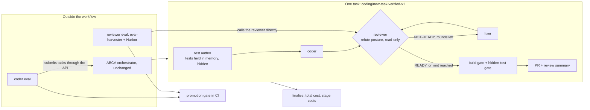

# Factory Plan: Learning Software Factory on ABCA

> Where this file lives: drafted at `kiro_projects/Autonomous agents/FACTORY_PLAN.md`. In Task 1, copy it into your fork as `docs/lab/FACTORY_PLAN.md` so Claude Code can read it in every session.

## How to use this plan with Claude Code

- **One task per session.** A session is one Claude Code conversation (from `claude` until you exit or type `/clear`). Do one task, check it, merge it, then start a fresh session for the next task. Long conversations fill Claude Code's context and quality drops; each task is a checkpoint. The plan file, code, tests and merged PRs carry everything forward between sessions.
- **Prompt for each session:** "Read docs/lab/FACTORY_PLAN.md. Do Task N only. Propose your approach first, then write the tests, then the code. Follow AGENTS.md. Stop when the Demo works. Write the exact demo steps and expected results into the PR description."
- **Run the demo yourself.** Every task ends with a Demo line describing what you should see working. Follow the steps in the PR description and check the result with your own eyes; don't rely on Claude Code saying "done". If it doesn't behave as described, have Claude Code fix it before merging.
- **Per-task loop (ABCA conventions):** open a GitHub issue in your fork → branch → `mise run build` → `/commit` → PR → `/review_pr` → run the demo → merge.
- **From Task 3 onward** you can let the factory build parts of itself: `bgagent submit --issue N` on a well-written issue. Review those PRs closely.

## Problem statement

Build a software factory you can learn from piece by piece: orchestrator, deterministic engine, adversarial review, test independence, observability, cost and evaluation. Start as a lab in a non-prod AWS account (learning) and grow into a team tool. Build on a fork of ABCA (aws-samples/sample-autonomous-cloud-coding-agents). Borrow patterns from AI-DLC v2, but no AI-DLC code.

## Requirements

- **Environment:** a dedicated non-prod AWS account and private GitHub repos created for the lab.
- **Repos and folders:**
  - The existing stock clone at `kiro_projects/Autonomous agents/sample-autonomous-cloud-coding-agents` stays unchanged, for experimenting with ABCA as-is.
  - All factory work happens in a separate Claude Code project folder, holding a clone of your own GitHub fork of ABCA.
  - The fork is for your own use. It does not need to merge back upstream or follow ABCA V2. An `upstream` remote is optional, only for picking up specific fixes such as security patches.
- **Tools:** Claude Code builds the project. The factory's coder runs on the Claude Agent SDK on Amazon Bedrock. Kiro is not required.
- **Budget:** no number fixed yet. The build produces cost data per task and per stage to inform that decision.
- **Opt-in:** existing ABCA workflows stay unchanged. New behaviour lives in a new workflow, `coding/new-task-verified-v1`.
- **Bug fixes and security patches** use the same workflows as features. There is no separate bugfix workflow; the test author's regression test covers that case.
- **Reviewer rules** (adapted from AI-DLC v2). Each rule prevents a known failure of LLM reviewers:
  - It sees only the issue and the diff, never the coder's reasoning. This prevents rubber-stamping.
  - It works from a "refute it" posture: READY is the verdict it fails to reach after hunting. This prevents leniency.
  - Only findings backed by evidence (file, line, tool or test output) can block. This prevents false alarms.
  - The verdict is a single READY or NOT-READY line, and code assigns the finding IDs.
  - Code caps the fix loop, by default at 2 rounds. This prevents endless loops.
  - A review that doesn't finish is retried once, then counts as NOT-READY. This prevents silent passes.
  - A verdict is tied to the commit SHA it reviewed. This prevents stale approvals.
  - It has its own turn cap.
  - Each workflow sets the review mode: `advisory`, `adversarial` or `none`.
- **Test author:**
  - A separate agent writes acceptance tests from the issue, and the coder never sees them.
  - Code checks each test before it counts. The test must fail on the starting code, and for evals it must also pass on a known-good reference.
  - It may mark a task "not testable", which falls back to review only.
- **Models:**
  - The reviewer and test author sit behind a pluggable backend.
  - Start with a different Claude tier, for example Opus for the coder and Sonnet for the reviewer and test author.
  - Add a non-Claude family next. A different family is more independent, with fewer shared blind spots.
  - Choose the model based on eval results.
- **Evals:** they run outside the workflow and test the whole factory.
  - **Coder eval:** cases are generated automatically from injected bugs and mined history, and code verifies each case.
  - **Reviewer eval:** uses eval-harvester (aws-samples/sample-code-eval-harvester), plus seeded flaws and labels taken from coder eval results.
  - **Promotion gate:** CI requires both evals before a workflow can be marked `production`.
- **Conventions:** follow ABCA's: an issue before each PR, mise tasks, tests in `agent/tests`, corpus fixtures, and an ADR for design changes.

## Background (from code research)

- Adding a step kind touches `agent/workflows/schema/workflow.schema.json` (the kind enum), `StepKind` in `agent/src/workflow/models.py`, a handler in `STEP_HANDLERS` in `agent/src/workflow/runner.py`, the validator sets in `agent/src/workflow/validator.py`, and corpus fixtures in `contracts/workflow-validation/`.
- On coding tasks, `agent/src/pipeline.py` (`_execute_agent_step`) runs only `run_agent` through the workflow runner (`only_kinds={"run_agent"}`); the build check and PR creation run inline. New steps must therefore be called inline from `pipeline.run_task`, after the coder's agent step and before the post-hooks (the build gate and PR creation). Otherwise they are silently skipped.
- Validator rule-2 allows exactly one `run_agent` per workflow, and ADR-014 defers multi-agent workflows to #99. New ADR-025 records why the new composite steps are an exception.
- `run_agent` (`agent/src/runner.py`) can be called again with `config.model_copy(update={...})`. Three problems:
  - `_setup_agent_env` changes process-wide environment variables (`ANTHROPIC_MODEL`).
  - `max_budget_usd` applies to each call separately.
  - `TaskResult.cost_usd` counts only one agent result.
- No retry or fix loop exists; `convergence: test_gated` only documents behaviour. Nothing enforces `promotion_gate`.
- Steps run through the runner emit `step:*` milestones, which `bgagent watch` shows. `agent/src/observability.py` `task_span` provides OpenTelemetry spans.
- `agent/src/prompts/pr_review.py` defines a reusable findings taxonomy: type, severity, title, description, proposed fix and AI prompt.
- `agent/run.sh` and `DRY_RUN=1` run the agent locally. `bgagent setup --features none` deploys the minimal profile.

## Proposed solution

| Workflow | Steps |
|---|---|
| `coding/new-task-v1` (existing, unchanged) | coder → build check → PR |
| `coding/new-task-verified-v1` (new, opt-in) | test author → coder → reviewer ⇄ fixer → build check + hidden tests → PR |

Choose a workflow per task with `--workflow`, or set a per-repo default. Compare the two workflows with the evals, and make the new one the default once it proves better.

## Things to watch (from the plan review)

1. **Keeping the hidden tests hidden.** The test author and the coder run in the same MicroVM, and the coder has Bash. The step code holds the tests in memory, outside the repo and off disk, while the coder runs, and a test proves they aren't present. This is lab-grade isolation, and stronger isolation is in the backlog.
2. **Tasks that can't be tested** (docs changes, vague issues) fall back to review only, with the reason recorded. The test author must not invent weak tests.
3. **Cost rises three to four times per task,** with up to four agent calls. The shared budget caps the total. Eval runs cost real money too: 10 cases × 2 workflows is 20 full tasks.
4. **Small evals are noisy.** Run each case N times, report ranges, and gate on thresholds rather than single scores.
5. **Lab setup checks:**
   - Make the sandbox repos **private**, so outsiders can't inject instructions through issues.
   - Check that the Claude models are enabled in Bedrock in your Region, and check their throughput quotas.
   - Check which non-Claude model families are available (needed for Task 10).
6. **Two deployments in one account:**
   - The stock clone keeps stack name `backgroundagent-dev`, and the fork uses `backgroundagent-dev-factory`. ABCA's least-privilege bootstrap requires the form `backgroundagent-dev[-suffix]`.
   - Use separate Cognito users and GitHub PATs, or a separate AWS account.
7. **Internal policy:** confirm that Claude Code, with Bedrock as the provider, is approved for this work.
8. **eval-harvester security:** its runner passes AWS credentials to the evaluated agent. Run it only in the lab account with a role scoped to it.

## Task breakdown

### Task 1: Fork, fix local tooling, and run locally
- Objective: a green fork, in its own Claude Code project folder, that runs a real task locally.
- Guidance:
  - On GitHub, fork `aws-samples/sample-autonomous-cloud-coding-agents` into your account or org, private if allowed.
  - Clone **your fork** into the new Claude Code project folder. Do not touch the existing stock clone.
  - Copy this file into the fork as `docs/lab/FACTORY_PLAN.md`.
  - Install with mise: `mise install`, then `mise run install`. If `prek install` fails because `core.hooksPath` is set globally, fix it at repo scope, not in global git config.
  - Create a private sandbox repo, `factory-sandbox-py`: a small Python service with build and test commands.
  - Create a fine-grained PAT scoped to that repo only.
  - Run with `DRY_RUN=1 ./agent/run.sh <owner>/factory-sandbox-py "<task>"`, then do a real run.
- Tests: `mise run build` and `mise //agent:quality` pass.
- Demo: the local agent opens a PR on the sandbox repo.

### Task 2: Deploy the baseline to the lab account and write a component tour
- Objective: the fork's ABCA running in the lab account, with each factory component identified.
- Guidance:
  - Confirm the account with `aws sts get-caller-identity`, and use least-privilege credentials.
  - Load the `builder-security` skill before deploying. Keep Cognito and webhook signing in place, and expose nothing extra.
  - Check Bedrock model access and quotas.
  - Deploy with `bgagent setup --features none` and stack name `backgroundagent-dev-factory`.
  - Store the PAT in Secrets Manager, create a Cognito user, run `bgagent configure` and `login`, then `bgagent repo onboard`.
  - Submit a feature task and a bug-fix task.
  - Write `docs/lab/FACTORY_TOUR.md`, mapping each component (orchestrator, deterministic steps, gates, cost, observability, isolation) to its code, AWS resource and dashboard.
- Tests: `mise //cdk:test` passes.
- Demo: a task submitted from the CLI ends in a PR, with a live `bgagent watch`, a CloudWatch dashboard, an X-Ray trace and a `bgagent budget status --me` figure.

### Task 3: Safe multiple agent calls per task (refactor, no behaviour change)
- Objective: the runtime can make several agent calls in one task.
- Guidance:
  - Add an `AgentInvocationLedger` that records each call's cost, turns, model and stage.
  - Restore or scope the environment variables changed by `_setup_agent_env`.
  - Give each call the remaining budget: `max_budget_usd - spent`.
  - `TaskResult.cost_usd` sums the ledger. `stage_costs` goes into the trajectory and events only, with no TaskTable schema change.
- Tests: the ledger sums correctly, each call gets only the remaining budget, environment variables are restored, and the existing pipeline tests pass unchanged.
- Demo: a normal task reports the same cost as before, and its trajectory shows a `coder` stage.

### Task 4: Reviewer step in advisory mode, with a pluggable backend
- Objective: an independent reviewer runs inside the task and records findings.
- Guidance:
  - Write ADR-025 (an addendum to ADR-014).
  - Add `agent/src/review/`:
    - a `ReviewerBackend` interface, with a Claude implementation that uses a copy of the config with `read_only=True` and a separate reviewer model and turn cap
    - the findings model and parser: a READY or NOT-READY line plus JSON findings that must cite evidence. Code assigns the IDs, and output that can't be parsed is treated as NOT-READY.
    - the reviewer prompt: the `pr_review` taxonomy plus the refute posture. Its input is only the issue and the diff against `origin/<default_branch>`.
  - Add the step kind `review_and_fix` (schema, `StepKind`, handler, validator sets, corpus fixtures) with `review_mode: advisory`.
  - Create the workflow `coding/new-task-verified-v1` and call the step inline from `pipeline.run_task`.
  - Record the reviewed commit SHA with each verdict, and put the review summary in the PR body.
- Tests:
  - The parser handles valid, malformed and incomplete output.
  - The corpus fixtures are updated.
  - The reviewer runs read-only, on its own model, without the coder's transcript, after the coder and before PR creation.
  - `new-task-v1` behaves exactly as before.
- Demo: a task on the new workflow shows the reviewer's findings in the PR, with coder and reviewer costs listed separately.

### Task 5: Adversarial mode (the bounded fix loop)
- Objective: findings that block send the work back to the coder.
- Guidance:
  - Add these settings: `review_mode: adversarial | advisory | none`, `max_iterations` (default 2), `block_on_severity` (default `major`, with evidence required), and `on_unresolved: fail | pr_with_warning` (the warning option adds a `review:unresolved` label).
  - The fixer gets the findings. Each re-review is a fresh reviewer session.
  - A review that doesn't finish is retried once, then counts as NOT-READY.
  - A verdict is refused if the reviewed SHA no longer matches the code.
  - The loop stops when the budget runs out, and records why.
- Tests, with `run_agent` mocked:
  - clean on the first pass
  - fixed on the second pass
  - still blocked at the cap, in each `on_unresolved` mode
  - a reviewer that doesn't finish
  - a stale SHA
  - budget exhausted partway through
- Demo: a seeded flaw (for example, missing input validation) goes from review to fix to a clean review, and the PR shows two rounds.

### Task 6: Observability for the new stages
- Objective: the new stages are visible everywhere ABCA reports progress.
- Guidance:
  - Add a `task_span` per stage and per round.
  - Emit `review_iteration_N` and test-author milestones through `_ProgressWriter`.
  - Show stage costs in `agent_cost_update`.
  - Add dashboard widgets: rounds per task, the share of tasks resolved by review, cost by stage, and the not-testable rate. Use metric filters or embedded metrics, with no new tables.
- Tests: progress writer tests, `watch.ts` tests and a CDK snapshot test.
- Demo: live rounds in `bgagent watch`, spans in X-Ray, and the new widgets on the dashboard.

### Task 7: Test author step and hidden-test gate
- Objective: one agent defines "done" and a different agent writes the code.
- Guidance:
  - Add the step `author_acceptance_tests`, which runs before the coder. It uses the reviewer backend interface with a separate model.
    - Input: the issue and the starting code.
    - Output: test files plus a short rationale, or a "not testable" verdict with a reason.
  - Validity check, done in code: the tests must run, and must fail on the starting code. Tests that fail the check are discarded, and the workflow falls back to review only.
  - Keep the tests in step memory, outside the repo and off disk, while the coder runs.
  - After the review loop, write the tests into a scratch copy and run them. This is a blocking gate that feeds the PR status and summary. A bug report naturally produces a regression test.
- Tests:
  - The tests are not on disk or in the repo during the coder's turn.
  - A test that passes on the starting code is rejected.
  - "Not testable" falls back correctly.
  - The gate passes and fails correctly.
- Demo: on a bug-report issue, the hidden test fails before the fix, the coder fixes the bug without seeing the test, and the gate passes.

### Task 8: Coder eval
- Objective: score workflows on repeatable cases, without hand-writing them.
- Guidance:
  - Add an `eval/coder/` package with `mise //eval:coder`. Each case is data: base commit, issue text and hidden tests.
  - Case generators:
    - **Injected bugs:** break working code, and keep a test only if it passes on the original and fails on the broken version.
    - **Mined history:** find past fix PRs whose tests fail before the fix and pass after it.
  - A model writes the issue text, and code verifies every case.
  - The runner submits the cases through the Task API, waits, runs the hidden tests on each PR, and collects cost, turns and rounds. It runs each case N times.
  - The report gives pass rate with a range, cost per passed task, and median turns, comparing two workflows side by side.
- Tests: unit tests for the generator validity checks, scoring and report, using recorded fixtures.
- Demo: a `new-task-v1` vs `new-task-verified-v1` report on generated cases.

### Task 9: Reviewer eval
- Objective: measure whether the reviewer catches real defects without raising false alarms.
- Guidance:
  - Add an entry point that runs the reviewer step on its own: a diff and an issue in, a verdict out. Harbor calls it.
  - Build the datasets:
    - seeded-flaw pairs (a clean version should be approved, a flawed one blocked)
    - coder eval PRs labelled by their hidden-test results, with a sample spot-checked by hand
    - eval-harvester on a public repo that has review history, run in the lab account with a scoped role
  - Score blocking accuracy, false-alarm rate and evidence quality.
- Tests: unit tests for the entry point and the scoring.
- Demo: a reviewer scorecard per model and prompt version.

### Task 10: A non-Claude backend for the reviewer and test author
- Objective: let a different model family serve as an independent checker.
- Guidance:
  - Implement `ReviewerBackend` with the Bedrock Converse API, using models enabled in your Region.
  - Give it minimal tools in code: read files, list files, and run the test command in a sandboxed subprocess. It gets no network or AWS access.
  - Permissions are enforced in the backend, because the Cedar hooks don't cover this path.
  - Choose the backend per workflow or per Blueprint.
- Tests: the tool allowlist is enforced, the output contract matches the Claude backend, and contract tests are shared between both backends.
- Demo: reviewer and coder eval results for the Claude tier vs the other family, with a model choice based on data.

### Task 11: Enforce the promotion gate
- Objective: no workflow is marked `production` without evals to back it.
- Guidance:
  - Add a CI check. A `production` workflow with `requires: [eval:coder:<suite>, eval:reviewer:<suite>]` needs committed reports for its current `prompt_version` that meet its thresholds and don't regress against the baseline.
  - Point `new-task-verified-v1` at these requirements.
- Tests: corpus cases for a missing report, a stale report, a result below threshold, and a pass.
- Demo: changing a prompt fails CI until fresh eval reports are committed.

### Task 12: Cost report and a backlog for team use
- Objective: data for the budget decision, and a path to a team tool.
- Guidance:
  - Add `mise //eval:cost-report`: cost by workflow, stage and model, projected across task volumes.
  - Write `docs/lab/HARDENING_BACKLOG.md`:
    - switch the DNS firewall from observation to blocking
    - replace the shared PAT with a GitHub App
    - review Cedar's default-permit behaviour
    - stronger isolation for hidden tests, such as a separate session or VM
    - multiple users and teams in Cognito
    - monthly budgets per team
    - the internal policy check on Claude Code use
- Tests: unit tests for the aggregation.
- Demo: a one-page cost report and a prioritised backlog.
